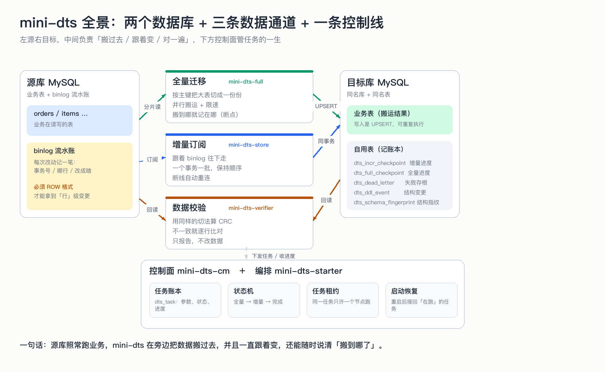
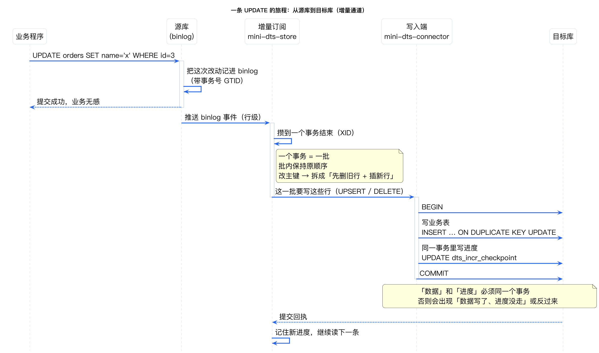
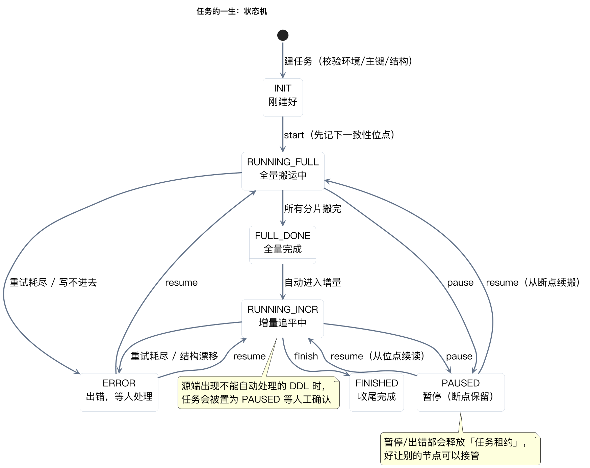
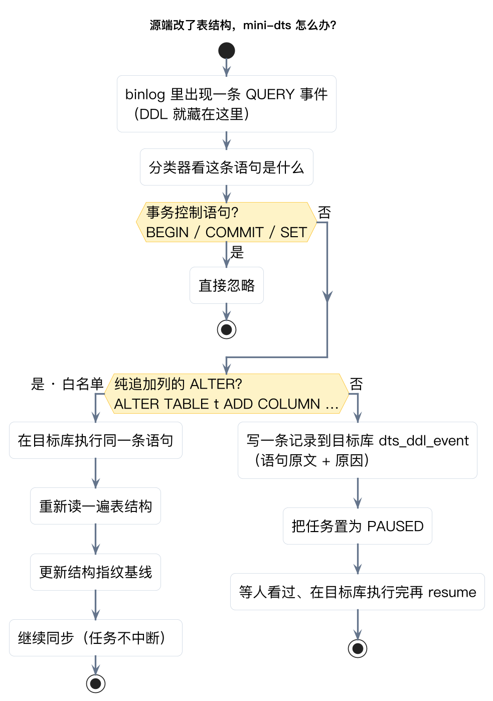

# mini-oms 重讲：从「一条数据的旅程」看它到底在干嘛

> 上一篇讲解（`docs/项目讲解.md`）是按代码文件顺序逐行注释的，适合查细节，不适合建立整体认识。
> 这篇换个顺序：**先说要解决什么问题 → 再看一条数据怎么走 → 最后才指代码在哪**。
> 全篇不需要 Java 基础，只需要知道「数据库有表、有主键、改动会写日志」。

---

## 0. 三句话版本

1. 你有一台 MySQL（**源库**），想把它的数据和**以后发生的变化**，搬到另一台 MySQL（**目标库**）。
2. 搬存量叫**全量**，跟着变化叫**增量**。难的不是各自做完，而是**在业务一直写着的前提下**把两段接上。
3. mini-oms 做这两件事，并且随时能说清「搬到哪了」：断电、重启、源端改表结构，都有明确应对，不会假装还在同步。

---

## 1. 先用搬家打比方

| 搬家要做的事 | mini-oms 里叫什么 | 不做会怎样 |
|---|---|---|
| 把所有家具先搬过去 | 全量迁移 | 目标库没有存量数据 |
| 搬家期间新买的东西再补一趟 | 增量订阅 | 目标库永远落后于源库 |
| 搬到一半记下「搬到第几个柜子」 | 断点续传 | 断电一次就得从头搬 |
| 同一个柜子搬两次不会变成两个柜子 | 幂等写入 | 重做时数据翻倍 |
| 搬完对一遍清单 | CRC 校验 | 不知道到底搬全没搬对 |

**但有个关键区别**：搬家可以让家里人先别往里放东西；线上数据库不能停。
所以整套设计都在回答一个问题——**业务一直在写，我怎么保证不丢、不重、还能中途停下**。

---

## 2. 全景：两个库 + 三条通道 + 一条控制线



看图抓三点：

- **三条通道各管一件事**：全量（搬存量）、增量（跟变化）、校验（对清单）。
  分开的好处是互不干扰：增量断线重连，不影响全量搬完的分片；校验读两份数据，也不改任何东西。
- **目标库里除了业务表，还有 5 张「自用表」**：增量进度、全量进度、写失败的存根、结构变更记录、表结构指纹。
  注意它们**和业务数据在同一个库**——这不是随便放的，后面第 4 节会看到它是「不丢不重」的物理前提。
- **控制面不碰数据**，只管任务的一生：参数、状态、进度汇报，以及「这个任务现在归谁跑」（任务租约）。

---

## 3. 为什么不能只做全量，也不能只做增量

- **只做全量**：一张大表搬 6 小时，这 6 小时里业务改了 10 万行。全量搬完那一刻，目标库已经落后 6 小时。
- **只做增量**：binlog 是滚动清理的（通常保留几天），历史数据根本不在 binlog 里。

所以顺序是固定的三步：

1. 全量开始**前**，先记一个起点标记（源库当前的事务位点，叫**一致性位点**）；
2. 全量把存量搬过去（这期间业务在写，目标库注定是「旧」的）；
3. 全量一结束，**从那个起点**开始回放 binlog，把全量期间的改动补齐，然后一直跟着。

因为是从「起点」而不是「全量结束时刻」开始回放，全量期间的写入会被**重放一遍**——
重放安全，靠的是写入是 UPSERT（同一行写两次结果一样）。

---

## 4. 一条 UPDATE 的旅程

这是整套系统最核心的一段路，看懂这张图，剩下的都是它的外围。



读图顺序：业务程序 → 源库 binlog → 增量订阅 → 写入端 → 目标库。两个细节值得单独说：

**① 为什么“一个事务一批”**
binlog 不是一行一条记录的流水，而是一堆事件（事务开始、行变更、事务提交）。
mini-oms 会等一个事务真正提交（读到 XID）才动手写，并且一批之内**保持原顺序**。
顺序很重要：同一个主键先插后改，颠倒过来结果就不同。

**② 为什么「数据」和「进度」必须写在同一个事务里**
图里最后两步是：写业务表 → 更新进度表 → COMMIT。
如果这两步不在一个事务，就会出现两种事故：

- 先写进度、后写数据：**进度超前** → 崩溃后从新进度继续，这段数据永久丢失；
- 先写数据、后写进度：**进度落后** → 崩溃后重放，数据被覆盖一遍（安全，因为有 UPSERT）。

结论：**进度可以落后，绝不能超前**。这就是为什么进度表必须和业务表同库同事务。

---

## 5. 任务的一生



正常路径只有一条：`刚建好 → 全量中 → 全量完成 → 增量中 → 完成`。
其余状态都是为「出事了怎么办」准备的：

- **暂停（PAUSED）**：手动 pause，或者源端出现了不能自动处理的表结构变更；
- **出错（ERROR）**：断线重连次数用尽、或者数据反复写不进去；
- 两个状态都能 `resume` 回来，**回到哪一步取决于「全量到底搬完没有」**，不是重新开始。

图里那句「暂停/出错都会释放任务租约」很关键：租约就是「这个任务现在归我跑」的凭据。
释放之后，别的节点才能接管——这是它能在多台机器上跑的原因。

---

## 6. 断电了会怎样（这段最值得看）


六帧对应六件事：

1. 全量把大表按主键切成 20 份，一份份搬；
2. 每搬完一份，**先在目标库写数据成功，再记一笔断点**；
3. 崩了：内存里的进度全丢，但「已写的数据 + 已记的断点」还在目标库里；
4. 重启：读断点，前 10 份直接跳过，从第 11 份继续；
5. 全量结束，但源库还在写，目标库仍然落后；
6. 增量从**一致性位点**回放 binlog，把差补上，最后 CRC 校验两边一致。

有两个「糟糕但可接受」的窗口，值得理解：

- **可能有一份数据写了、断点没记上**（第 3 帧）→ 重启后这份会被**重做一遍**。
  重做不产生脏数据，因为写入是 UPSERT。这就是「断点宁可靠后，不可靠前」。
- **重放是至少一次，不是恰好一次**（第 4~6 帧）→ 目标端可能被写两遍，最终状态仍然正确。

一句话：**这套系统不追求「每条只处理一次」，而追求「处理多少次结果都一样」。** 这比前者容易得多，也更抗崩溃。

---

## 7. 五个「为什么这样设计」

**Q1：进度为什么记 GTID，而不是自己缓存 binlog？**
缓存 binlog 要自己维护文件、自己算位置、自己处理过期，还会因为进程重启丢掉。
GTID 是源库自己维护的「我已经执行到哪些事务」，重连时只要说「这几个事务之后的都给我」即可，权威、不丢。
参考：[MySQL GTID 概念](https://dev.mysql.com/doc/refman/8.0/en/replication-gtids.html)

**Q2：为什么先写数据、再记断点？反过来不行吗？**
反过来就是「进度超前」——记了断点但数据没写，崩溃后从断点继续，那段数据永久缺失。
现在的顺序最坏情况只是**重做**，重做靠幂等兜底。

**Q3：为什么按主键切片，而不是 `LIMIT offset, n` 一页页翻？**
`LIMIT` 翻到第 10 万页时，数据库仍要扫过前面所有行，越翻越慢（业内叫深分页问题）；
而且翻页期间有人插入，会导致某些行被跳过或重复。按主键范围切片（每片记一个主键上界）则稳定、可续跑、还能并行。

**Q4：为什么必须要主键？**
主键同时是三种东西的钥匙：断点键（搬到哪）、幂等键（同一行是谁）、校验分片的边界。
所以「无主键表」在建任务时就被直接拒绝，而不是等到跑起来才莫名出错。

**Q5：为什么源库必须 `binlog_format=ROW`？**
`STATEMENT` 格式的 binlog 只记 SQL 语句，不记「哪一行从什么改成什么」。
拿不到行级前后值，就没法在目标端做幂等写入，也没法只应用某些行。
参考：[MySQL binlog 格式](https://dev.mysql.com/doc/refman/8.0/en/binary-log-formats.html)、
[INSERT … ON DUPLICATE KEY UPDATE（UPSERT 的依据）](https://dev.mysql.com/doc/refman/8.0/en/insert-on-duplicate.html)

另外，建任务时会先做环境体检：`log_bin=ON`、`binlog_format=ROW`、`binlog_row_image=FULL`、`gtid_mode=ON`，
不满足就**当场拒绝建任务**，而不是半夜同步挂了才发现。

---

## 8. 源端改表结构怎么办



DDL 藏在 binlog 的 QUERY 事件里（老实现把这类事件整类忽略，等于把结构变更全丢了）。现在的处置是三条路：

| 情况 | 例子 | 处置 |
|---|---|---|
| 事务控制语句 | `BEGIN` / `COMMIT` / `SET …` | 忽略 |
| 纯追加列（白名单） | `ALTER TABLE t ADD COLUMN c …` | 目标端自动执行 → 重新读结构 → 继续同步 |
| 其余结构变更 | `MODIFY` / `DROP` / `RENAME` / `CREATE` / `TRUNCATE` / `ADD INDEX` | 记一条台账 → 任务转「暂停」等人确认 |

台账（目标库 `oms_ddl_event`）会保存**语句原文**，人工在目标库执行完再 `resume` 即可。
另外建任务时会给每张表算一个「结构指纹」，运行期每次连上源库都复核一遍——
即便有人绕过 binlog 手工改了表结构，也会在写入之前被拦住。

---

## 9. 现在能做到哪，做不到哪

**能做到**

- 大表按主键切片并行搬 + 限速，搬到一半可以停、可以换机器接着搬
- binlog 增量跟随，断线自动重连（指数退避），重试次数用尽才报错
- 数据与进度同事务，崩溃后靠幂等收敛，最终一致
- 追加列自动同步；其它 DDL 记台账并暂停等人
- 多节点部署：任务租约排他，节点挂了别的节点能从目标库断点接管
- 实例级 + 任务级两层限速，避免多任务叠加速度把源库打穿

**做不到（当前边界，写清楚免得误会）**

- 一份任务 = 一个源库 → 一个同名目标库；不支持改库名、多源合并、分库分表聚合
- 只支持单列主键；复合主键、无主键表在建任务时被拒绝
- DDL 白名单只覆盖纯追加列，其它都要人工
- 各模块仍是同一个进程内的 Java 接口（按模块分包，但没拆成独立服务/RPC）
- 校验采用「不一致就重读一次」，没有做真正的一致性快照

---

## 10. 三分钟自己跑一遍

```bash
mvn test                                  # 单元测试，不需要 Docker
mvn -pl mini-oms-starter spring-boot:run  # 起服务，默认 :8080
```

```bash
# 建任务：源库、目标库、schema 三者库名必须一致（不一致会直接报错，防写错库）
curl -X POST localhost:8080/api/tasks -H 'Content-Type: application/json' -d '{
  "sourceUrl":"jdbc:mysql://src:3306/shop","sourceUser":"u","sourcePassword":"p",
  "targetUrl":"jdbc:mysql://tgt:3306/shop","targetUser":"u","targetPassword":"p",
  "schema":"shop","tables":["orders"],"chunkSize":1000,"parallelism":4,"rowsPerSecond":50000}'

curl -X POST localhost:8080/api/tasks/{id}/start    # 全量 → 自动进增量
curl localhost:8080/api/tasks/{id}/metrics          # 看进度：rowsCopied / incrTxApplied / 重连次数
curl -X POST localhost:8080/api/tasks/{id}/verify   # 对清单
```

看 `metrics` 时重点关注四个值：`state`（现在处在哪一步）、`rowsCopied`（全量搬了多少行）、
`incrCheckpointGtid`（增量进度）、`incrReconnects`（重连过几次——不是 0 也不用慌，是它在自愈）。

---

## 速查卡

| 要点 | 一句话 |
|---|---|
| 三条通道 | 全量（搬存量）、增量（跟变化）、校验（对清单） |
| 控制面 | 只管任务的一生：参数、状态、谁在跑 |
| 目标库自用表 | 增量进度、全量进度、死信、DDL 台账、结构指纹 |
| 不丢不重靠三件事 | 断点宁可靠后、幂等 UPSERT、数据与位点同事务 |
| 一句话 | 源库照常跑业务，我在旁边搬，并随时说清搬到哪了 |

## 11. 想继续深入时看哪里

| 想搞清楚 | 直接看 |
|---|---|
| 整体入口与编排顺序 | `mini-oms-starter/.../MigrationEngineImpl.java`（顶部注释写了红线时序） |
| 增量怎么读 binlog、怎么重连、怎么处 DDL | `mini-oms-store/.../BinlogStoreService.java`、`DdlClassifier.java` |
| 幂等写入、数据与位点同事务 | `mini-oms-connector/.../MySqlSink.java` |
| 全量切片与断点续传 | `mini-oms-full/.../FullTransferService.java` |
| 校验怎么比 | `mini-oms-verifier/.../VerifyService.java` |
| 任务租约 / 启动恢复 | `mini-oms-cm/.../TaskLeaseManager.java`、`mini-oms-starter/.../TaskRecovery.java` |
| 设计取舍与已知局限 | `README.md` 的「红线 → 代码」与「已知局限」 |

**这份文档只是「地图」，看不懂细节是正常的。**
任何一处想展开（比如「幂等写入到底怎么写的」「租约抢不到会怎样」「GTID 是啥」），
直接在群里问我，我可以按你的节奏再用图讲一遍——想听哪块就点哪块。
