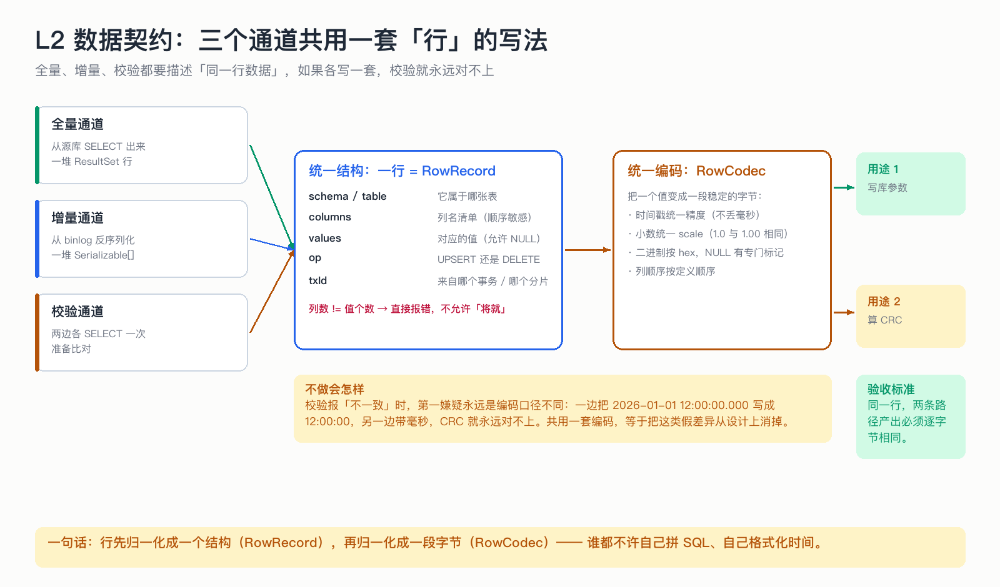

# L2 数据契约：三个通道共用一套「行」的写法

> 上一节讲了全景。这一节回答一个看起来很小、但决定校验能不能对上账的问题：**同一行数据，在三条通道里必须长得一模一样。**

## 为什么这节重要

你可能会想：全量从数据库里 `SELECT` 出来是 `ResultSet`，增量从 binlog 反序列化出来是 `Serializable[]`，本来就不一样，为什么要强求一样？

因为**校验要做的事情是「比较」**。如果两边（甚至三条路径）对同一行的表示不同，比出来的差异全是假的——你会花几天时间去追一个根本不存在的 bug。这类系统最贵的成本不是搬数据，是**误报**。

## 机制

**第一层：统一结构。** 无论数据来自哪里，都先变成一个固定形状的记录：

| 字段 | 含义 | 为什么必须有 |
|---|---|---|
| schema / table | 属于哪张表 | 增量要按表过滤，写库要定位 |
| columns | 列名清单（顺序敏感） | 生成 SQL 时列与值必须一一对应 |
| values | 对应的值，允许 NULL | `List.copyOf` 拒绝 null，所以要专门处理 |
| op | UPSERT 还是 DELETE | 决定生成哪种语句 |
| txId | 来自哪个事务 / 哪个分片 | 出错时能定位到「哪一批」 |

**第二层：统一编码。** 值本身也要归一化后才能比较：时间戳统一精度（不能一边带毫秒一边不带）、小数统一 scale（`1.0` 与 `1.00` 视为相同）、二进制转 hex、NULL 有专门标记。

这就是「一个出口」原则：**行 → 结构 → 字节**，每一步都只有一个实现。

## 不做会出什么事故

- 全量读出来的时间戳带毫秒，增量写出时不带 → 校验永远报差异，但数据其实是对的；
- 小数 `1.0` vs `1.00` 参与 CRC → 同样的值算出不同结果；
- 列顺序在两条路径里不一致 → 生成 SQL 时列名和值错位，写进错误的列（这条最致命，会污染数据）。

## 自测（先答再看答案）

1. 为什么「统一编码」比「统一结构」更难做到？
2. 如果只有校验通道用了另一套编码，会出什么现象？
3. `columns` 与 `values` 长度不一致时，系统的选择是什么？

答案

1. 结构是形状问题，一眼能对齐；编码是语义问题（精度、scale、字符集、时区），分散在每一处取值的地方，最容易各写一套。
2. 只有校验会「一直报差异」，而写入本身是对的 —— 于是你会怀疑搬数据，其实错在比较方式。
3. 直接抛错（`columns/values size mismatch`），不允许「将就补齐」，因为补出来的值一定是错的。

## 速查卡

| 要点 | 一句话 |
|---|---|
| 行结构 | schema/table/columns/values/op/txId |
| 编码出口 | 只有一个：RowCodec |
| 归一化 | 时间精度、小数 scale、binary→hex、NULL 标记 |
| 顺序 | columns 顺序 = 定义顺序，三处一致 |
| 失败策略 | 列数≠值数 → 直接报错 |

## 想看代码

`mini-oms-common/.../RowRecord.java`（结构）、`RowCodec.java`（编码）、`Values.java`（归一化）

> 有任何一处想细看（比如「scale 到底怎么统一的」），问我，我给你逐行讲这三处。
