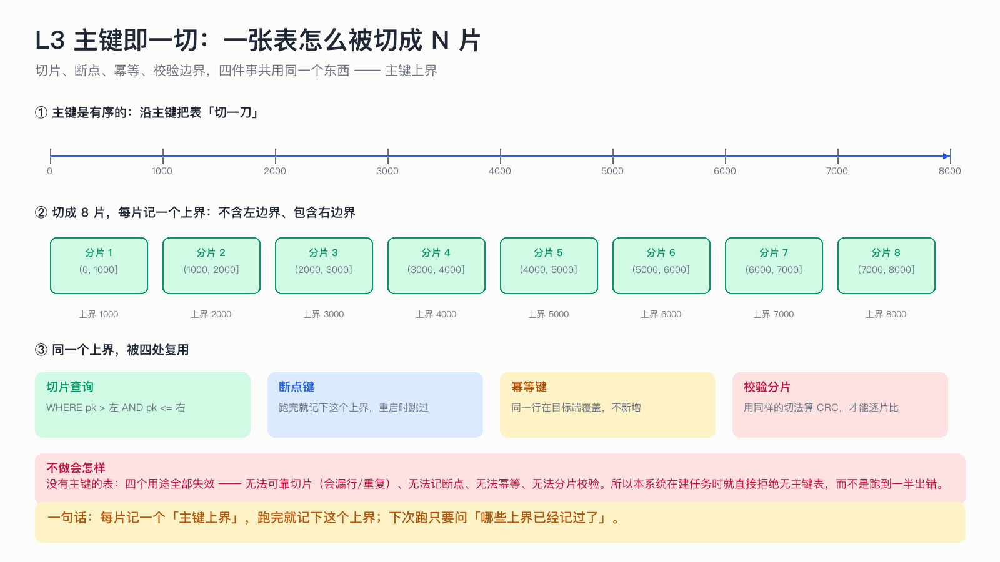

# L3 主键即一切：切片、断点、幂等、校验共用一个上界

> 前三节里出现最多的词是「断点」。这一节说清楚断点到底是什么：**它就是一个主键上界值。**

## 为什么这节重要

大表不能一口气搬完，必须切开。切法有很多种（按行号、按 offset、按时间），但只有一种能同时满足「可续跑 + 可并行 + 可校验 + 可幂等」——**按主键范围切**。

理解这一点之后，你会发现很多看似独立的机制其实是同一个东西的四个用途。

## 机制

1. **扫描上界**：先只在主键上做一次扫描，每隔 N 行取一个主键值，得到 N 个「上界」。
2. **每片是一个左开右闭区间**：`(上一个上界, 这个上界]`。左开是为了「不重」，右闭是为了「不漏」。
3. **搬一片 = 查 `WHERE pk > 左 AND pk <= 右`**，写完就记下这个上界。
4. **恢复 = 问一句「哪些上界已经记过了」**，跳过它们即可。

## 四个用途（同一个值）

| 用途 | 怎么用这个上界 |
|---|---|
| 切片查询 | 作为 `WHERE` 的右边界 |
| 断点 | 作为「这片做完了」的标记 |
| 幂等 | 由主键确定「是哪一行」，覆盖而不是新增 |
| 校验 | 用同样的切法算 CRC，才能一片片对上 |

## 不做会出什么事故

- **按 offset 翻页**：翻到第 10 万页时数据库仍要扫过前面所有行（深分页），越搬越慢；而且中途有人插入，会导致某些行被跳过、某些行被重复。
- **无主键表**：四个用途全部失效——无法可靠切片、无法记断点、无法幂等、无法分片校验。所以系统在建任务时直接拒绝，而不是跑到一半出错。
- **复合主键**：当前版本同样拒绝（断点键与幂等键都按单列设计），这条边界写在 README 里。

## 自测

1. 为什么是左开右闭，而不是左闭右开？
2. 1000 行、chunkSize=100，会切出几片？最后一片可能有多少行？
3. 如果搬完一片但没记断点，重启后会怎样？

答案

1. 左开保证相邻片不重叠（不重），右闭保证边界那一行不丢（不漏）。
2. 10 片；最后一片可能不足 100 行（取决于主键分布是否连续，主键有大空洞时每片行数都可能远小于 100）。
3. 这片数据会被重做一遍；因为写入是 UPSERT，结果仍然正确——这就是「断点宁可靠后」的由来。

## 速查卡

| 要点 | 一句话 |
|---|---|
| 切法 | 按主键范围，每片记上界 |
| 区间 | 左开右闭 `(lo, hi]` |
| 断点键 | 上界的编码值 |
| 已完成的判据 | 上界在断点集合里 |
| 拒绝条件 | 无主键 / 复合主键 / 主键类型不支持 |

## 想看代码

`mini-oms-common/.../JdbcPkBoundaryScanner.java`（扫上界）、`PkResolver.java`（主键解析）、`Chunk.java`（区间模型）
