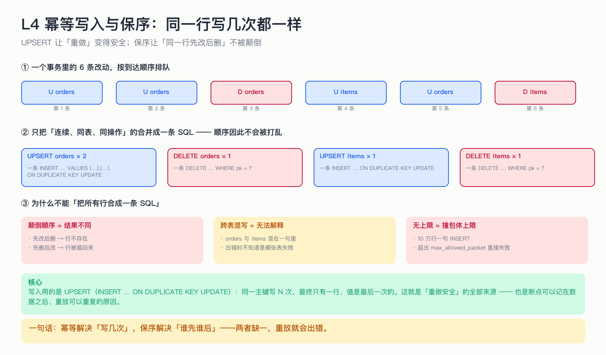

# L4 幂等写入与保序：同一行写几次都一样

> 断点只能保证「最多重做一片」，真正让重做安全的是**幂等**。这一节讲清楚幂等靠什么成立，以及为什么必须同时保序。

## 为什么这节重要

整套系统的时间线里到处都是「可能重复」：崩溃后重放、增量从更早的位点回放、全量期间的重叠窗口。
如果写入不是幂等的，上面每一条都会造成数据错误。**幂等不是一个优化，是系统正确性的地基。**

## 机制

**① 幂等靠 UPSERT。** 写入形式是 `INSERT ... ON DUPLICATE KEY UPDATE`：
- 主键不存在 → 插入；
- 主键已存在 → 更新成这次的值。

所以同一个主键写 N 次，最终只有一行，值是最后一次的。**前提是目标表的主键/唯一键与源一致**——这也是建任务时要校验主键的原因。

**② 保序靠「连续同表同操作」才合并。** 一个事务里的改动按到达顺序排队，只有相邻、同表、同操作的那些才合并成一条多行 SQL；顺序一变就断开分组。

**③ 语句要切片。** 一条 INSERT 最多 500 行。10 万行拼成一条会撞 `max_allowed_packet`，整批失败、连累整个事务进死信。

## 不做会出什么事故

| 错误做法 | 后果 |
|---|---|
| 把所有行合成一条 SQL | 顺序被打乱：先改后删 → 行不存在；先删后改 → 行被插回来 |
| 不分表混写 | 失败时无法定位是哪张表、哪一行 |
| 不设行数上限 | 大事务撞包体上限，整批写入失败 |
| 用普通 `INSERT` 而不是 UPSERT | 重做直接主键冲突报错 |

## 自测

1. `UPDATE orders SET name='x' WHERE id=3` 重复写两次，结果和写一次有什么不同？
2. 为什么「先改后删」和「先删后改」的最终结果不同？系统怎么防止顺序被破坏？
3. 为什么单条语句要限制 500 行，而不是「越大越快」？

答案

1. 没有不同。第二次只是把同样的值再写一遍——这正是幂等的含义。
2. 因为「删」针对的是那一行的存在性：先删了后面就改不到。系统只合并相邻同表同操作的记录，绝不重排。
3. 行数越大，单条 SQL 的字节数越大，超过 `max_allowed_packet` 会直接失败；而失败要重试、重试再失败就进死信，代价远高于多几条语句。

## 速查卡

| 要点 | 一句话 |
|---|---|
| 幂等写法 | `INSERT … ON DUPLICATE KEY UPDATE` |
| 前提 | 目标端主键与源一致 |
| 合并规则 | 只合并相邻、同表、同操作 |
| 上限 | 单条语句 ≤ 500 行 |
| 失败兜底 | 逐行重试一次，仍失败落死信表 |

## 想看代码

`mini-oms-connector/.../MySqlSink.java`（`splitRuns` / `doWrite` / 死信）
