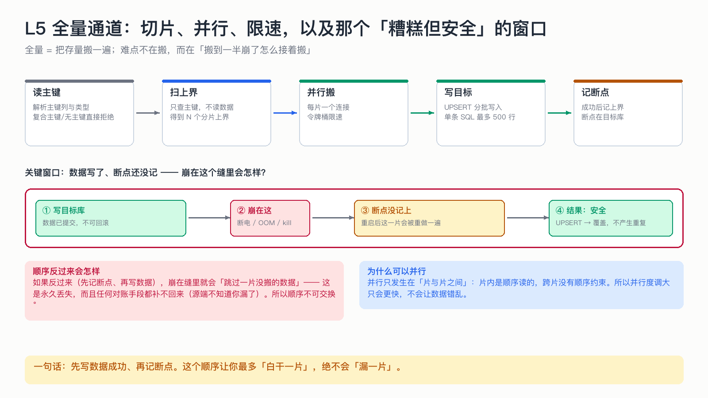

# L5 全量通道：切片、并行、限速，以及那个「糟糕但安全」的窗口

> 全量的难点不在「搬」，而在「搬到一半崩了怎么接着搬」，以及「并行会不会让数据乱」。

## 为什么这节重要

全量是唯一一条会长时间、大流量压源库的通道。两个问题必须回答：
1. 崩了怎么办？（→ 断点顺序）
2. 能不能并行？（→ 并行边界在哪）

## 机制

**流程**：读主键 → 扫上界 → 并行搬每一片 → 写目标库 → 记断点。

- **扫上界只查主键**，不读数据，所以很快，也不给源库太大压力；
- **每一片一个独立连接**（连接和事务不能跨线程共享）；
- **令牌桶限速**：按行/秒发放预算，两层（实例级总预算 + 任务级预算），避免多任务叠加把源库打穿；
- **权重顺序**：先写数据成功 → 再记断点。**这个顺序不可交换。**

## 那个窗口到底是什么

崩在「数据已提交、断点还没记」这个缝里，重启后这一片会被重做一遍。
因为写入是 UPSERT，重做只是覆盖，不产生重复——所以这个窗口是「糟糕但安全」。

反过来（先记断点、再写数据），崩在缝里会「跳过一片从没搬过的数据」——**永久丢失**，且任何对账都补不回来（源端不知道你漏了）。

## 并行为什么安全

并行只发生在**片与片之间**。片内是顺序读的，跨片之间没有顺序约束（不同主键区间互不相干）。
所以并行度调大只会更快，不会让数据错乱。

## 不做会出什么事故

| 做法 | 事故 |
|---|---|
| 先记断点后写数据 | 崩溃后永久丢一片 |
| 多个 worker 共用一个连接 | 事务互相干扰，提交时序不可控 |
| 不限速 | 全量把源库 IO/CPU 打满，业务受影响 |
| 片内也并行且不按主键排序 | 无法保证「片内顺序」，重做边界模糊 |

## 自测

1. 为什么「先写数据、再记断点」不会丢数据？最坏情况是什么？
2. 并行度从 4 调到 16，需要改代码吗？会不会让数据错？
3. 令牌桶的两层预算分别保护谁？

答案

1. 最坏是「白干一片」（重做一次），因为数据先落地了；绝不会出现「断点说有、实际没搬」。
2. 不用改代码，配置项即可；不会错，因为并行只在片之间。
3. 任务级保护「单个任务别太贪」，实例级保护「所有任务加起来别把源库打穿」。

## 速查卡

| 要点 | 一句话 |
|---|---|
| 顺序红线 | 先写数据，后记断点 |
| 并行边界 | 只在片之间 |
| 断点位置 | 目标库 `dts_full_checkpoint` |
| 限速 | 实例级 + 任务级两层令牌桶 |
| 恢复语义 | 跳过已完成上界，重做未记的那一片 |

## 想看代码

`mini-dts-full/.../FullTransferService.java`、`mini-dts-common/.../TokenBucket.java`、`GlobalRateLimiter.java`
