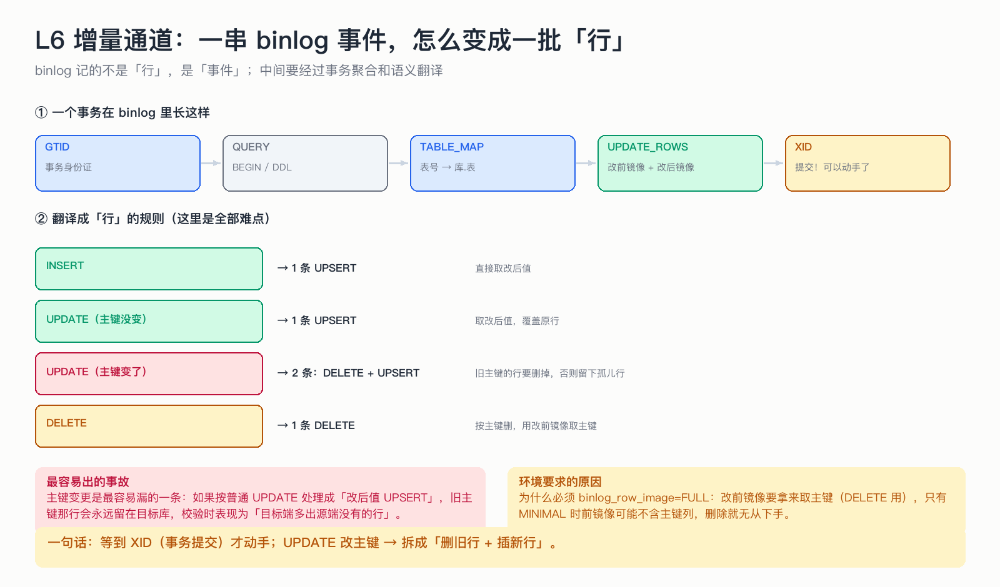

# L6 增量通道：一串 binlog 事件，怎么变成一批「行」

> binlog 记的不是「行」，是「事件」。中间要经过两道加工：事务聚合、语义翻译。

## 为什么这节重要

增量是这套系统里最容易出错的一段：事件类型多、顺序敏感、边界条件多（主键变更、大事务、无 GTID 事务）。
搞清「事件 → 行」的映射规则，等于掌握了 80% 的 bug 来源。

## 机制

**① 一个事务在 binlog 里长这样**

`GTID`（事务身份证） → `QUERY`（BEGIN / DDL） → `TABLE_MAP`（表号→库.表） → `*_ROWS`（行变更） → `XID`（提交）。

关键：**读到 XID 才动手写**。之前的行变更只是先攒在内存里。这样一批 = 一个源事务，批内顺序与源库一致。

**② 翻译规则**

| 源端动作 | 变成几条记录 | 为什么 |
|---|---|---|
| INSERT | 1 条 UPSERT | 直接取改后值 |
| UPDATE（主键没变） | 1 条 UPSERT | 覆盖原行 |
| **UPDATE（主键变了）** | **2 条：DELETE + UPSERT** | 旧主键的行必须删掉，否则留下孤儿行 |
| DELETE | 1 条 DELETE | 用改前镜像取主键 |

主键变更这一条是最容易漏的：如果按普通 UPDATE 处理，旧主键那行会永远留在目标库，校验时表现为「目标端多出源端没有的行」。

**③ 边界处理**

- `QUERY` 事件里可能藏着 DDL（第 11 节专门讲）和 `BEGIN`/`COMMIT`（忽略）；
- 大事务不能全塞内存：缓冲到阈值就先落一批（位点不动），最后一次提交才推进位点；
- 没有 GTID 的事务说明源库没开 `gtid_mode`，环境预检已经拦过，这里只做兜底跳过。

## 不做会出什么事故

| 做法 | 事故 |
|---|---|
| 不等 XID 就逐条写 | 半截事务落库，崩溃后无法判断该不该补 |
| 主键变更当普通更新 | 目标端留孤儿行，数据「变多」 |
| 大事务全放内存 | OOM 或撞包体上限 |
| 表过滤只比表名不比库名 | 同实例其它库的同名表被混进来（真实踩过的坑） |

## 自测

1. 一个事务里改了 3 行、其中 1 行的主键也改了，最终会产生几条记录？
2. 为什么必须等到 XID 才写？如果不等到 XID 会怎样？
3. 表过滤为什么必须「库名 + 表名」双条件？

答案

1. 4 条：2 条普通 UPSERT + 主键变更的那 1 行拆成 DELETE + UPSERT。
2. 事务边界是「原子」的最小单位；不等 XID 就写，等于把半个事务落库，崩溃后既不能安全回滚也不能安全重放。
3. 同一实例里可能有多个库有同名表（`db_a.orders` 和 `db_b.orders`），只比表名会串库写入。

## 速查卡

| 要点 | 一句话 |
|---|---|
| 批边界 | GTID … XID 一个事务一批 |
| 顺序 | 批内保持源库到达顺序 |
| 主键变更 | DELETE 旧行 + UPSERT 新行 |
| 大事务 | 缓冲上限，超了先落一批（位点不动） |
| 表过滤 | 库名 + 表名双键 |

## 想看代码

`mini-oms-store/.../BinlogStoreService.java`、`BinlogRecordMapper.java`
