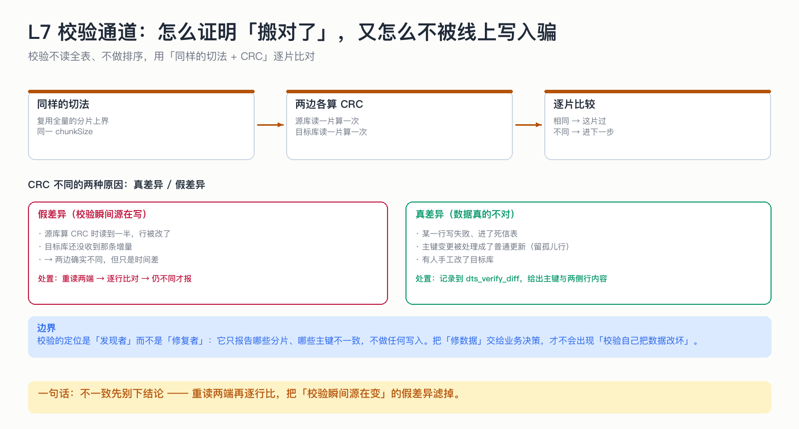

# L7 校验通道：怎么证明「搬对了」，又怎么不被线上写入骗

> 校验不读全表、不做排序，用「同样的切法 + CRC」逐片比对；不一致时先别下结论。

## 为什么这节重要

迁移最怕的不是失败，是「以为成功了」。校验是把「我觉得搬完了」变成「我能证明搬完了」的唯一手段。
但校验自己也很容易报假警——线上数据在动，这一刻的差异可能只是时间差。

## 机制

1. **复用全量的切法**：同样的主键上界、同样的 chunkSize。两边用同一把尺子，结果才可比。
2. **每片算一次 CRC**：源库读一片算一个值，目标库读一片算一个值。
3. **先比 CRC**：相同 → 这片过；不同 → 进入下一步。
4. **重读两端逐行比**：只对不一致的分片、只重读这一片，找出具体哪些主键不同。
5. **只报告，不改数据**。

## 假差异 vs 真差异

| 类型 | 原因 | 处置 |
|---|---|---|
| 假差异 | 校验瞬间源在写：源库算 CRC 时读到一半被改，目标库还没收到那条增量 | 重读两端再比，仍不同才报 |
| 真差异 | 某行写失败进了死信、主键变更处理成普通更新、有人手工改了目标库 | 记录到差异表，给出主键与两侧行内容 |

## 为什么校验自己不能修数据

如果校验自动「把源的值覆盖到目标」，那么在源端误删、目标端被人工修正这类场景下，校验会把「对的数据」改坏。
**发现和修复必须分开**：校验负责看见，修数据由人决策。

## 不做会出什么事故

| 做法 | 事故 |
|---|---|
| 校验用自己的切法 | 分片边界不同，CRC 必然不同，全是假差异 |
| 不复用编码口径 | 同上，而且很难查 |
| 差异直接自动修 | 把人工修正过的数据覆盖回去 |
| 只对总量 | 行数相同不代表内容相同（改一行少一行） |

## 自测

1. 为什么校验要和全量用同一套切法？
2. CRC 不一致时，为什么不能直接报「数据错了」？
3. 校验发现了差异，它会自动修复吗？为什么？

答案

1. 分片边界不同 → 两片包含的行不同 → CRC 天然不同，比出来的差异没有意义。
2. 因为线上还在写：这一片在「源已改、目标未到」的瞬间必然不一致，需要重读两端再判断。
3. 不会。发现与修复分离，避免把人工修正过的正确数据覆盖掉。

## 速查卡

| 要点 | 一句话 |
|---|---|
| 切法 | 与全量完全一致 |
| 第一层 | 分片 CRC 比快 |
| 第二层 | 不一致的分片重读、逐行比 |
| 输出 | 差异表：分片号 + 主键 + 两侧行 |
| 定位 | 只发现问题，不改数据 |

## 想看代码

`mini-oms-verifier/.../VerifyService.java`
