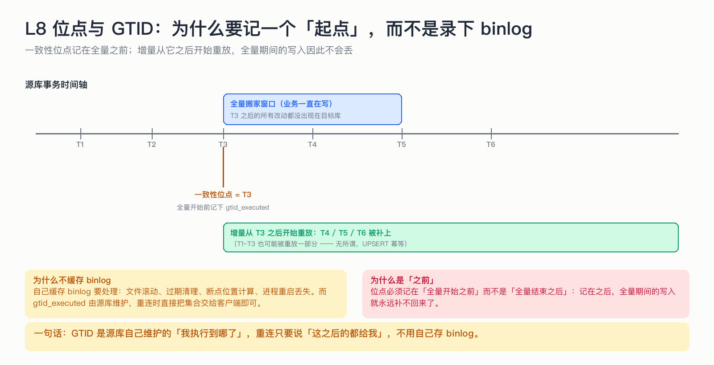

# L8 位点与 GTID：为什么要记一个「起点」，而不是录下 binlog

> 增量要「接着上一次」往下读，这个「上一次」就是位点。问题是：位点该记成什么？

## 为什么这节重要

位点是整套系统的坐标系。记错位置，后面全错；记错类型（比如自己存 binlog 文件位置），会额外背上「文件滚动、过期清理、进程重启丢失」这一堆麻烦。
GTID 把这些问题变成一行字符串。

## 机制

**GTID 是什么**：源库给每个事务分配的唯一编号（`uuid:序号`），并且自己维护「我已经执行过哪些事务」的集合（`gtid_executed`）。
增量订阅只要把这个集合交给客户端，意思就是：**这之后的都给我。**

**一致性位点**：全量开始**之前**，读一次源库的 `gtid_executed` 记下来。
全量结束后，从**这个位点**开始回放，而不是从「全量结束时刻」开始。

为什么？因为全量期间业务一直在写：
- 从「开始前」回放 → 全量期间的写入会被重放一遍（幂等，安全）；
- 从「结束后」回放 → 全量期间那些改动**永远补不回来**。

## 为什么不自己缓存 binlog

| 自己缓存 | 用 GTID |
|---|---|
| 要处理文件滚动、过期清理 | 源库自己管 |
| 要自己算位置、自己记录 | 一个字符串就是位点 |
| 进程重启容易丢 | 存在目标库，换节点也能读 |
| 多源/主从切换时容易乱 | 集合语义天然支持多 sid |

## 不做会出什么事故

- 位点记在「全量结束之后」→ 全量期间的增量永久缺失；
- 位点只记在内存里 → 重启后从当前时间开始，中间那段全丢；
- 用 `binlog 文件 + 偏移量` 记位点 → binlog 被 purge 后无法定位，任务无法恢复。

## 自测

1. 一致性位点为什么要在全量「之前」记录？
2. GTID 位点是一行字符串，它记录的是「读了哪些」还是「执行了哪些」？
3. 如果源库主从切换了，GTID 位点还能用吗？

答案

1. 只有从「开始前」回放，才能覆盖全量期间发生的所有写入；从「结束后」回放会漏掉这一段。
2. 记录的是「源库执行到哪个事务」，回放从它之后继续；不是「我读到了哪个文件位置」。
3. 只要新主库的 GTID 集合包含旧位点（这是切换的前提），就能继续用；这正是 GTID 比文件位点更强的地方。

## 速查卡

| 要点 | 一句话 |
|---|---|
| 位点类型 | GTID 集合（`uuid:1-n`） |
| 一致性位点 | 全量开始**前**读取 |
| 增量起点 | 全量完成 → 从一致性位点回放 |
| 存放位置 | 目标库 `oms_incr_checkpoint` |
| 环境要求 | `gtid_mode=ON`（建任务时预检） |

## 想看代码

`mini-oms-common/.../GtidState.java`、`MasterStatusReader.java`
