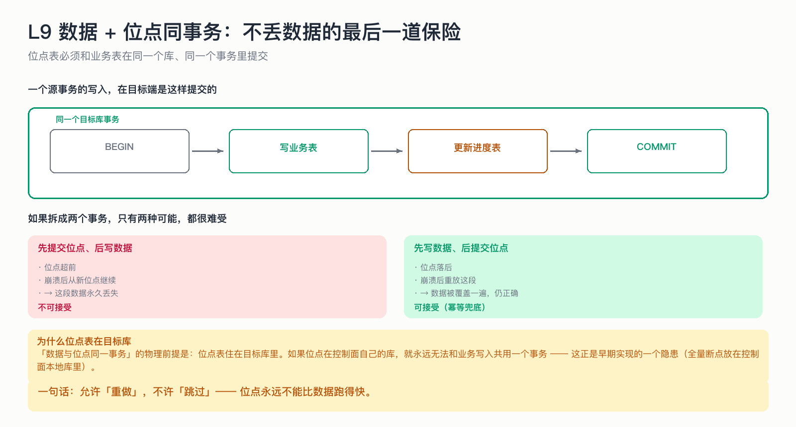

# L9 数据 + 位点同事务：不丢数据的最后一道保险

> 前面说了「位点不能超前」。这一节说清楚它是怎么被**物理保证**的：位点表和业务表在同一个库、同一个事务里提交。

## 为什么这节重要

「不丢数据」不是一个态度，是一个可以证明的性质。证明的核心就一句话：
**允许重做，不允许跳过。** 而要做到这一点，数据与位点必须在同一个原子操作里落地。



## 机制

一个源事务在目标端的写入长这样：

```
BEGIN
  写业务表（UPSERT / DELETE）
  更新进度表（dts_incr_checkpoint ← 新 GTID）
COMMIT
```

任一步失败 → 整体回滚 → 位点不动 → 下次从旧位点重放（幂等收敛）。

## 两种错误顺序，后果不同

| 顺序 | 崩溃后的状态 | 结果 |
|---|---|---|
| 先提交位点、后写数据 | 位点超前 | **这段数据永久丢失**，不可接受 |
| 先写数据、后提交位点 | 位点落后 | 这段数据被重放一遍，仍然正确 |

这就是为什么「同事务」不是洁癖，而是唯一能同时排除「丢」和「错」的写法。

## 为什么位点表必须住在目标库

如果位点存在控制面自己的数据库里，就永远无法和业务写入共用一个事务——两个库不在一个事务里，中间任何时刻崩溃都会留下不一致。
早期实现曾把**全量断点**放在控制面本地库，这就是一个隐患：换节点断点就没了。

## 不做会出什么事故

| 做法 | 事故 |
|---|---|
| 数据和位点分两个事务提交 | 位点超前丢数据 / 位点落后重放（前者致命） |
| 位点存在控制面本地磁盘 | 换节点后断点丢失，任务从头再来 |
| 位点在数据库里但用了另一个连接/库 | 依然不在一个事务里，等于没做 |

## 自测

1. 为什么「位点落后」是可接受的，「位点超前」是不可接受的？
2. 同事务写入的物理前提是什么？
3. 如果业务表写成功、位点更新失败，会发生什么？

<details>
<summary>答案</summary>

1. 落后只是多做一次（幂等覆盖）；超前会让一段数据永远没人重放，等于丢数据。
2. 位点表与业务表在同一个目标库里，能用同一个连接、同一个事务提交。
3. 整体回滚：业务表那次写入也不会生效，位点不动，下次从旧位点重放。

</details>

## 速查卡

| 要点 | 一句话 |
|---|---|
| 原子单位 | 一个源事务 = 一个目标事务 |
| 事务内含 | 业务写入 + 位点更新 |
| 失败处理 | 整体回滚，位点不动 |
| 位点位置 | 目标库（同库才能同事务） |
| 可证明性质 | 位点绝不超前，进程恢复后最多重做 |

## 想看代码

`mini-dts-connector/.../MySqlSink.java`（`doWrite`）、`TargetSchemaInit.java`（位点表）
