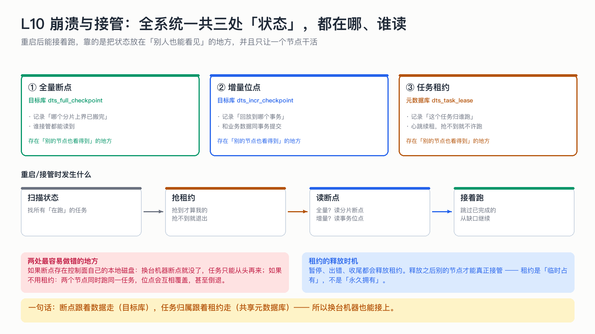

# L10 崩溃与接管：全系统一共三处「状态」，都在哪、谁读

> 这一节是整套课程的中枢：把「断点、位点、租约」放到同一张图里，你就能回答任意时刻崩溃会发生什么。

## 为什么这节重要

前几节的断点、位点是「数据侧」的记忆；但还有一类记忆是「谁在干活」。三处状态各管一段，混淆它们是最常见的理解错误。

## 三处状态

| # | 状态 | 存在哪 | 记录什么 | 谁读它 |
|---|---|---|---|---|
| ① | 全量断点 | 目标库 `dts_full_checkpoint` | 哪个分片上界已搬完 | 任何接管者 |
| ② | 增量位点 | 目标库 `dts_incr_checkpoint` | 回放到哪个事务 | 任何接管者 |
| ③ | 任务租约 | 元数据库 `dts_task_lease` | 这个任务归哪个节点跑 | 抢任务的节点 |

共同点：**都放在「别人也看得到」的地方**。放在内存或本地磁盘的记忆，换台机器就没了。

## 接管流程

扫描「DB 说在跑」的任务 → 抢租约（抢不到就退出）→ 读断点 → 跳过已完成的、从缺口继续。

这就是「进程重启后任务自己接着跑」的全部秘密：**状态在库里，不在内存里。**

## 两张动图对照

第 1 课的那个 GIF 演示的是「全量崩了怎么接」；这里再回顾一次三处状态的配合：

- 全量阶段只关心 ①（分片断点）和 ③（谁在跑）；
- 增量阶段只关心 ②（事务位点）和 ③；
- 切换（全量→增量）的那一刻，用的是「全量开始前记下的一致性位点」，不是当时的时间点。

## 不做会出什么事故

| 做法 | 事故 |
|---|---|
| 断点存本地磁盘 | 换节点从头搬；大表意味着数小时重来 |
| 没有租约 | 两个节点同时跑同一任务，位点互相覆盖甚至倒退 |
| 重启后不扫描状态 | DB 写着「在跑」、实际没线程 —— 假活，最危险 |
| 租约永不释放 | 原节点挂了，新节点永远抢不到 |

## 自测

1. 三处状态里，哪两处必须放在目标库？为什么？
2. 两个节点同时 start 同一个任务，没有租约会怎样？
3. 租约在什么时候释放？

答案

1. 全量断点与增量位点：它们要和「数据」同处一地（位点还要同事务），而且必须能被接管者读到。
2. 两个 binlog 客户端同时跑，位点各自前进、互相覆盖，可能出现位点倒退 → 重复回放窗口扩大，且资源翻倍。
3. pause / 出错 / finish 都会释放；心跳续租失败（说明被接管）也会停手并放弃。

## 速查卡

| 要点 | 一句话 |
|---|---|
| 断点（全量） | 目标库，按分片上界 |
| 位点（增量） | 目标库，与数据同事务 |
| 租约 | 元数据库，心跳续租 |
| 接管 | 抢租约 → 读断点 → 跳过已完成 |
| 假活 | 状态在跑但指标不动 = 故障 |

## 想看代码

`mini-dts-cm/.../TaskLeaseManager.java`、`mini-dts-starter/.../TaskRecovery.java`、`MigrationEngineImpl.java`
