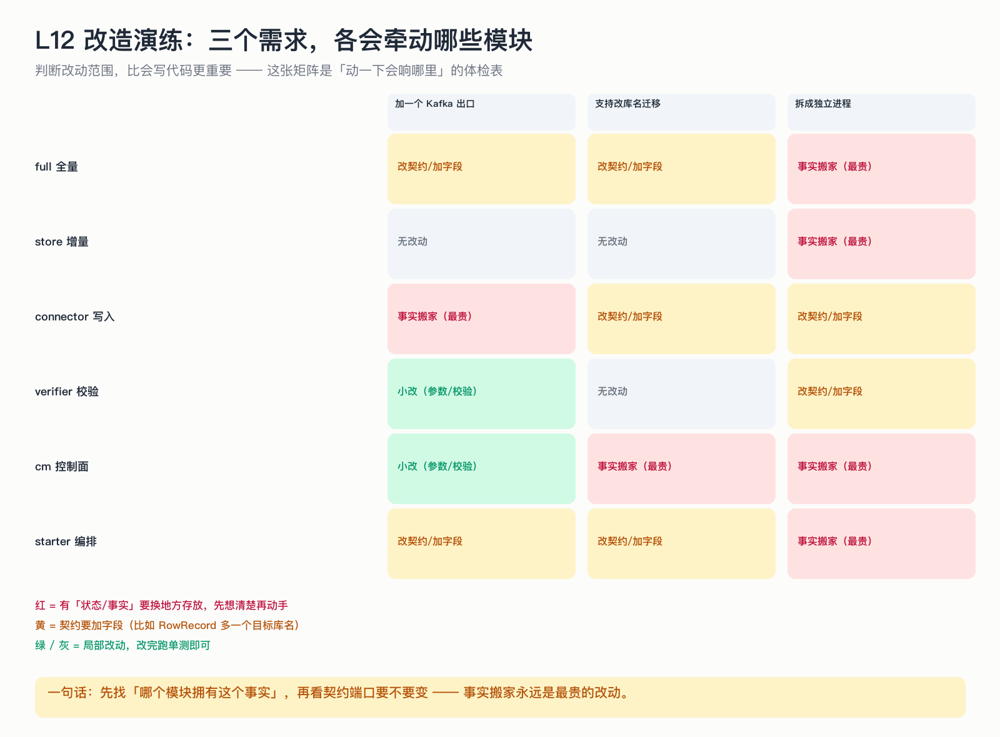

# L12 改造演练：三个需求，各会牵动哪些模块

> 会读代码只是及格线。真正的能力是：拿到一个需求，能先说出「会响哪几个地方」。

## 为什么这节重要

前面十一节都在讲「它现在长什么样」。这一节讲「想让它变形时，代价在哪」——这也是面试和评审里最常被问到的判断力。

## 三个需求，三种代价

| 需求 | 关键判断 | 最贵的部分 |
|---|---|---|
| 加一个 Kafka 出口 | 出口是「多一个 Sink 实现」还是「多一份数据事实」？ | 幂等语义要在 Kafka 侧重做（消息没有主键覆盖） |
| 支持改库名迁移 | 目标库名从「URL 决定」变成「任务参数」 | 库名是**事实**：要落库、要透传到所有写入点、要改校验 |
| 拆成独立进程 | 端口接口够不够、状态能不能被外部读 | 状态搬家：`runtimes` 在内存里，得变成可查询的任务表 |

一句话规律：**先问「哪个模块拥有这个事实」，再看契约端口要不要改；事实搬家永远是最贵的。**

## 三个需求的骨架

**① 加 Kafka 出口**
新增一个 `Sink` 实现（写入语义从「UPSERT」变成「发消息 + 目标端去重」），
`RowRecord` 不用改，全量/增量都不用改 —— 因为写入端是端口（`Sink` 接口）。

**② 支持改库名**
`RowRecord` 可能要加一个目标库名（或把库名作为 Sink 的构造参数）；
建任务校验要放开；校验通道也要按目标库名读；元数据要存目标库名（重启后仍要知道）。

**③ 拆成独立进程**
`Sink / TargetAdmin / TaskStateNotifier / FullCheckpointStore` 已经是端口，换成 RPC 客户端即可；
真正的难点是 `runtimes`（内存中的运行时表）要变成「可被别的进程查询的状态」——这就是租约表已经在做的事。

## 自测

1. 为什么「加 Kafka 出口」比「改库名」便宜？
2. 拆进程时，哪些接口不用改、哪些必须改？
3. 一个需求进来，你怎么在 5 分钟内判断「贵不贵」？

答案

1. 加出口只是多一个实现（端口已存在）；改库名要改「事实」——它被校验、写入、元数据多处引用。
2. 端口接口（Sink / TargetAdmin / 通知器 / 断点存储）不用改，换实现即可；必须改的是「进程内状态」——运行时表、线程模型。
3. 先找这个事实现在存在哪、被谁读；凡是「事实要换存放位置」的，就是最贵的一类。

## 速查卡

| 判断维度 | 问题 |
|---|---|
| 事实归属 | 这个信息现在存在哪？谁读？ |
| 契约变更 | 端口签名要不要变？`RowRecord` 要不要加字段？ |
| 语义重做 | 目标端写语义是否要重做（如 Kafka 无 UPSERT） |
| 状态搬家 | 内存状态是否要落库（多进程前提） |
| 测试成本 | 哪些现有测试会失效？要补哪一层？ |

## 想看代码

接口端口：`mini-oms-connector/.../Sink.java`、`mini-oms-common/.../TargetAdmin.java`、`FullCheckpointStore.java`、`TaskStateNotifier.java`
