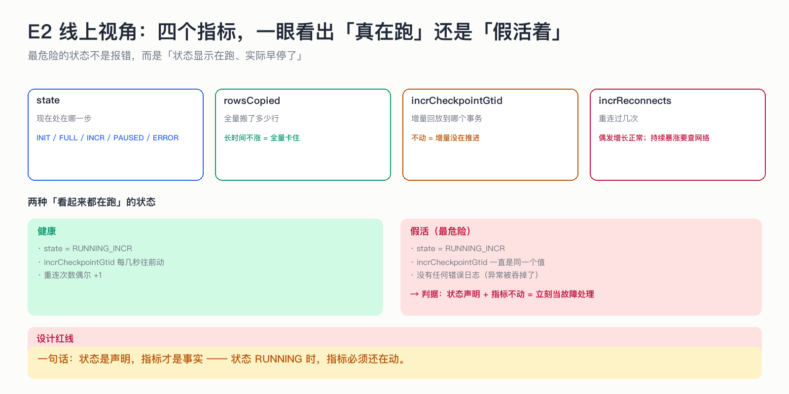

# E2 线上视角：四个指标，一眼看出「真在跑」还是「假活着」

> 最危险的状态不是报错，而是「状态显示在跑、实际早停了」。

## 为什么这节重要

迁移任务的故障经常是「安静的」：进程还在、接口还能查、状态还是 RUNNING，但同步早在半小时前就停了。
没有指标，你要等到业务发现数据不对才知道——那时候已经落后几小时。

## 四个指标

| 指标 | 看什么 | 异常信号 |
|---|---|---|
| `state` | 现在处在哪一步 | 长时间停在 FULL_DONE 说明没进增量 |
| `rowsCopied` | 全量搬了多少行 | 长时间不涨 = 全量卡住 |
| `incrCheckpointGtid` | 增量回放到哪个事务 | 不动 = 增量没推进 |
| `incrReconnects` | 重连次数 | 偶发正常；持续暴涨查网络/源库 |

判据很简单：**状态说 RUNNING，指标就必须还在动。** 状态声明 + 指标不动 = 立刻当故障处理。

## 「假活」是怎么发生的

事件处理抛异常 → 连接被关掉 → 但异常被上层吞掉 → 线程结束、状态没变 → 从此静默。
这类 bug 的修法不是加日志，而是**把失败路径强制落到状态上**：要么重试，要么报错，不许沉默。

## 不做会出什么事故

| 做法 | 事故 |
|---|---|
| 只暴露 state | 假活完全看不出来 |
| 异常只打日志不改状态 | 日志没人看，任务停摆数小时 |
| 没有重连计数 | 不知道是「偶发」还是「网络一直不通」 |
| 指标只在内存 | 进程重启后全归零，无法回溯 |

## 自测

1. 为什么 `state=RUNNING_INCR` 不能作为「健康」的证据？
2. `incrReconnects` 缓慢增长要不要报警？持续暴涨呢？
3. 怎么从设计上避免「静默死亡」？

答案

1. 状态只是声明；只有增量位点在推进才证明真的在同步。
2. 缓慢增长是自愈的正常表现；持续暴涨说明链路有系统性问题（网络/源库重启/权限）。
3. 失败路径必须显式回调控制面（重试 → 耗尽转 ERROR），不允许「线程自己结束、状态不变」。

## 速查卡

| 要点 | 一句话 |
|---|---|
| 必看 4 指标 | state / rowsCopied / incrCheckpointGtid / incrReconnects |
| 健康判据 | 指标在动，不只是状态在跑 |
| 假活定义 | 状态 RUNNING + 指标冻结 |
| 设计红线 | 失败必须可见，宁可报红不要静默 |

## 想看代码

`mini-dts-starter/.../MigrationEngineImpl.java`（`metrics`）、`mini-dts-store/.../BinlogStoreService.java`（错误分类与重连计数）
