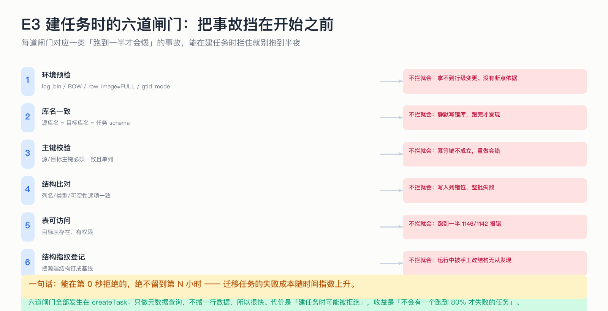

# E3 建任务时的六道闸门：把事故挡在开始之前

> 能在第 0 秒拒绝的，绝不留到第 N 小时 —— 迁移任务的失败成本随时间指数上升。

## 为什么这节重要

一个任务跑到 80% 才失败，损失的不只是时间：目标库已有半份数据、源库被压过一轮、还可能有人已经开始用目标库读数据。
所以「建任务」这个动作其实是一组校验的集合，而不是简单的插入一行配置。

## 六道闸门

| # | 闸门 | 检查什么 | 不拦会怎样 |
|---|---|---|---|
| 1 | 环境预检 | `log_bin=ON` / `binlog_format=ROW` / `row_image=FULL` / `gtid_mode=ON` | 拿不到行级变更、没有断点依据 |
| 2 | 库名一致 | 源库名 = 目标库名 = 任务 schema | 静默写错库，跑完才发现 |
| 3 | 主键校验 | 源/目标主键一致且单列、类型支持 | 幂等键不成立，重做会错 |
| 4 | 结构比对 | 列名 / 类型 / 可空性逐项一致 | 写入列错位，整批失败 |
| 5 | 表可访问 | 目标表存在、有权限 | 跑到一半报 1146/1142 |
| 6 | 结构指纹登记 | 把源端结构钉成基线 | 运行中被手工改结构无从发现 |

## 为什么都放在建任务时

这些检查只做**元数据查询**，不搬一行数据，所以很快（毫秒级）。
代价是「建任务时可能被拒绝」，收益是「不会有一个跑到 80% 才失败的任务」。

## 不做会出什么事故

真实世界的版本：目标库名写错一个字母 → 任务正常跑完 → 几天后发现目标库是空的（数据写进了另一个库）。
或者：`binlog_format` 是 STATEMENT → 增量拿不到行 → 报错重试直到失败 → 这时候全量已经跑了几小时。

## 自测

1. 六道闸门里，哪一道挡的是「静默错误」而不是「明显报错」？
2. 为什么结构比对要放建任务时，而不是运行中？
3. 结构指纹登记之后，运行期怎么用它？

答案

1. 库名一致（写错库不报错）和结构指纹（结构漂移不会立刻报错）。
2. 运行中才发现意味着已经有数据写偏了/失败了一批；建任务时比对只是两次元数据查询。
3. 每次（重）连源库时重算指纹并与基线比较，不一致就拒绝继续。

## 速查卡

| 要点 | 一句话 |
|---|---|
| 时机 | 全部在 `createTask`，只查元数据 |
| 原则 | 能早拒就早拒 |
| 静默风险 | 库名、结构漂移 |
| 指纹 | 建任务登记、运行期复核 |
| 成本 | 毫秒级，值得 |

## 想看代码

`mini-dts-starter/.../MigrationEngineImpl.java`（`createTask`）、`mini-dts-store/.../MySqlEnvChecker.java`
